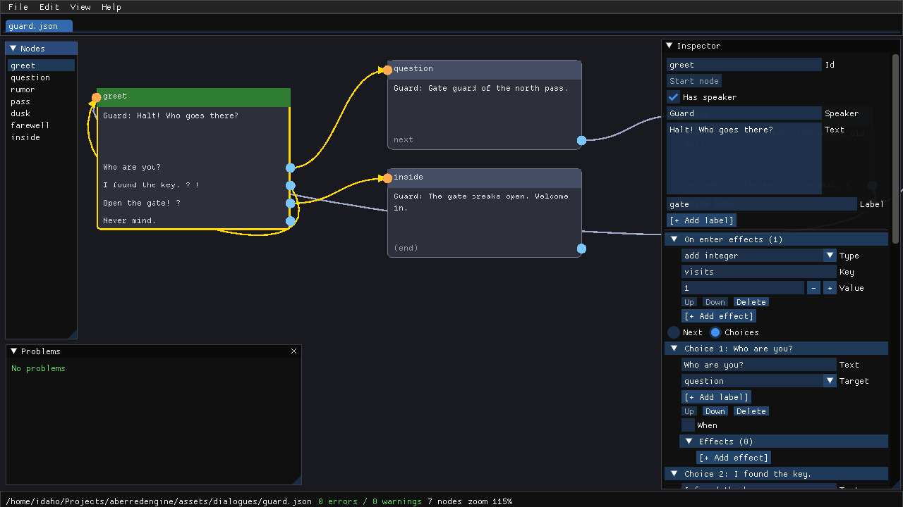

# AberredDialogueEditor

A visual node-graph editor for [AberredEngine](https://github.com/idaho06/aberredengine) dialogue JSON files.

Dialogues are graphs of nodes: each node has a line of text, an optional speaker, and either one `next` link or a
list of player choices. Choices can carry conditions (`when`) and effects over the game's world signals. The
editor loads any dialogue JSON the engine accepts (plus some it rejects, so you can fix them), lays the graph out
automatically, lets you edit every field, shows all validation problems live, and saves JSON that the engine
loads unchanged.



## Features

- Node graph canvas: drag nodes, drag links between pins, pan, zoom, frame-all, auto-layout.
- Inspector for the selected node: id, speaker, text, labels, start flag, `next` or choices (target, `when`
  condition, effects, labels per choice) and on-enter effects. Conditions (`flag`, `integer`, `string_equals`,
  `not`, `all`, `any`) and effects (`set_flag`, `remove_flag`, `set_integer`, `add_integer`, `set_scalar`,
  `set_string`) are edited with recursive editors.
- Live validation in a Problems window: every error and warning at once, with click-to-select.
- Saving is gated by the engine's own validation, so a saved file always loads in a game.
- Multiple documents in tabs, with unsaved-changes prompts, native open/save dialogs and atomic saves.

## Documentation

- [docs/dialogue-authoring.md](docs/dialogue-authoring.md) — using the editor to write dialogues, the JSON
  reference, and loading the files from Rust and Lua games.
- [docs/architecture.md](docs/architecture.md) — layers, threads, data flow and the module map.
- [docs/contributing.md](docs/contributing.md) — development setup, conventions and "how to add ..." recipes.
- [docs/gotchas.md](docs/gotchas.md) — engine, imgui and threading pitfalls, each with its symptom and rule.
- [CHANGELOG.md](CHANGELOG.md) — release notes.

## Build and run

Prerequisites:

- A stable Rust toolchain with edition 2024 support (rustup recommended).
- [`just`](https://github.com/casey/just) for the task recipes (`cargo install just`, or your package manager).
- The native raylib build dependencies (the engine builds raylib from source): a C toolchain, CMake and, on
  Linux, the X11/Wayland, GL and audio development packages. The engine's README lists a starting set for
  Debian/Ubuntu; on Windows see the engine's `WINDOWS.md`.
- Network access on the first build: the engine is a git dependency, pinned by `rev` in `Cargo.toml`.

```sh
git clone https://github.com/idaho06/aberreddialogueeditor
cd aberreddialogueeditor
just run            # or: cargo run --release
```

| Recipe       | What it runs                                                                                      |
|--------------|---------------------------------------------------------------------------------------------------|
| `just check` | `cargo fmt --check` + `cargo clippy --all-targets -- -D warnings` + `cargo test` (default recipe) |
| `just test`  | `cargo test`                                                                                      |
| `just lint`  | `cargo clippy --all-targets -- -D warnings`                                                       |
| `just run`   | `cargo run`                                                                                       |
| `just fmt`   | `cargo fmt`                                                                                       |

Debug logging (projection, lint and action events; never document content):

```sh
RUST_LOG=aberreddialogueeditor=debug just run
```

The default log level is `info`. The window is configured in `config.ini` (1280x720, 60 Hz).

## Controls

The same list is available in the app under Help > Controls.

| Action | Input |
|---|---|
| Move a node | Left-drag its body or header |
| Select a node | Left-click it |
| Connect nodes | Drag from a right-side pin onto another node |
| Disconnect | Drag a linked pin off onto empty space |
| Context menu | Right-click |
| Pan | Middle-drag or Right-drag |
| Zoom | Mouse wheel |
| Frame all | F or View > Frame all |
| Re-layout | View > Re-layout |
| Add node | Right-click canvas > Add node here, or Edit > Add node |
| Delete node | Delete key or right-click > Delete node |
| New / Open / Save / Save As / Close tab / Quit | Ctrl+N / Ctrl+O / Ctrl+S / Ctrl+Shift+S / Ctrl+W / Ctrl+Q |
| Toggle the Problems window | Ctrl+Shift+P or View > Problems |

Shortcuts only fire when no text field has focus and no modal is open. Around the graph there is one tab per
open document, a Nodes window listing node ids and load warnings, the Inspector, the Problems window, and a status
bar with the file path (and a `*` when unsaved), error and warning counts, node count and zoom. Help > About shows
the version.

## File format

The saved file is exactly the engine's `DialogueDef` serialized as pretty JSON with a trailing newline, written
atomically (to `<path>.tmp`, then renamed over the target).

- No extra fields are added. Node positions are **not** saved: they are editor-side view state, and every open
  re-runs the auto-layout.
- Saving is gated by the engine: a document the engine would reject writes nothing, and a "Cannot save" dialog
  shows the engine's own error. The engine reports one error at a time (duplicate node id, missing start, a node
  with both `next` and `choices`, an empty `choices` list, an unknown `next` target); the Problems window lists
  all of them. Warnings, such as unreachable nodes, never block saving.
- Loading is tolerant: a file the engine would reject still opens, with load warnings and dangling links kept
  visible so you can fix it.

```json
{
  "start": "greet",
  "nodes": [
    {
      "id": "greet",
      "speaker": "Guard",
      "text": "Halt! Who goes there?",
      "choices": [
        { "text": "A friend.", "next": "friend" },
        {
          "text": "Here is my pass.",
          "next": "pass",
          "when": { "type": "flag", "key": "has_pass" },
          "effects": [{ "type": "set_flag", "key": "pass_shown" }]
        }
      ]
    },
    { "id": "friend", "speaker": "Guard", "text": "Hm. Move along." },
    { "id": "pass", "speaker": "Guard", "text": "Carry on.", "next": "friend" }
  ]
}
```

The full field reference, with every condition and effect, is in
[docs/dialogue-authoring.md](docs/dialogue-authoring.md).

## Using the saved file in a game

Rust, with the engine's `DialogueStore` and `DialogueRunner`:

```rust
use aberredengine::prelude::*;
use std::sync::Arc;

fn setup(mut dialogues: ResMut<DialogueStore>) {
    match load_dialogue("assets/dialogue/guard.json") {
        Ok(tree) => {
            dialogues.insert("guard", Arc::new(tree));
        }
        Err(err) => log::error!("cannot load guard dialogue: {err}"),
    }
}
```

Lua, in the engine's scripting API:

```lua
engine.load_dialogue("guard", "./assets/dialogue/guard.json")
-- then attach it to an entity: engine.spawn():with_dialogue("guard") ...
```

[docs/dialogue-authoring.md](docs/dialogue-authoring.md) covers driving the conversation (advance, choose,
cancel), the dialogue events and the Lua callbacks.

## Limitations

- No undo/redo and no preview/play mode; the only preview is the edge shown while dragging a link.
- Node positions are not saved: every open re-runs the auto-layout (View > Re-layout re-runs it on demand).
- Nodes have a fixed size (240 px wide, at most 4 wrapped text lines); longer text is truncated with `...`.
- Closing the OS window quits immediately even with unsaved changes — the engine polls the window's close
  flag itself and offers no close-request hook, so the unsaved-changes prompt only runs on File > Quit / Ctrl+Q.
- One native file dialog at a time; while one is open, Open/Save As requests are ignored and tab closes are
  suspended.
- Edges cannot be clicked: remove a link by dragging its pin off onto empty space, or by choosing "(end)" in
  the Inspector's target combo. Dropping a dragged link on empty space never creates a node.

## License

MIT, see [LICENSE](LICENSE).
